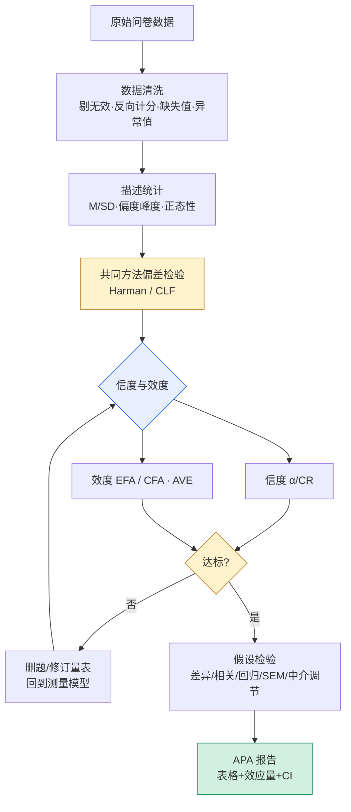
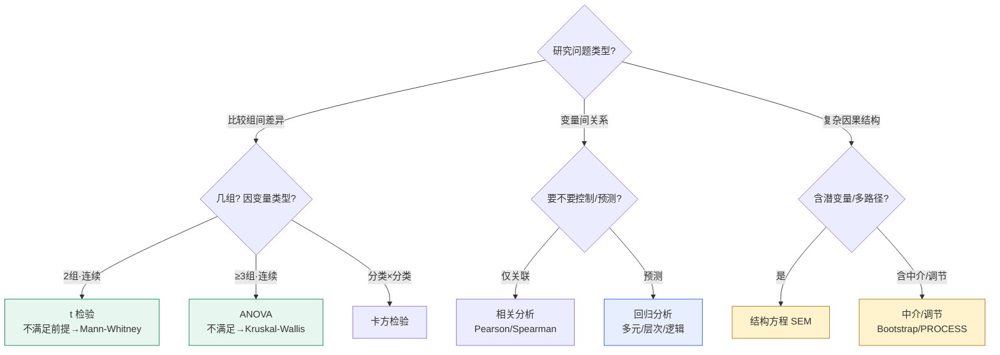
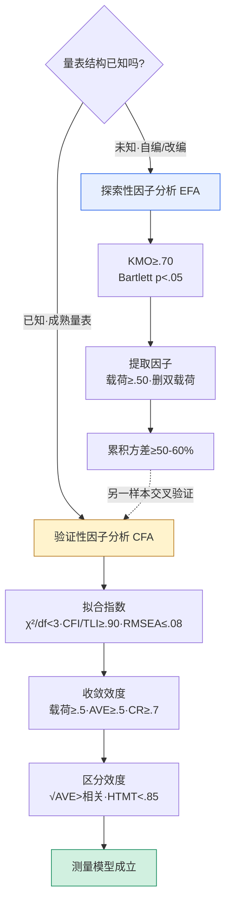
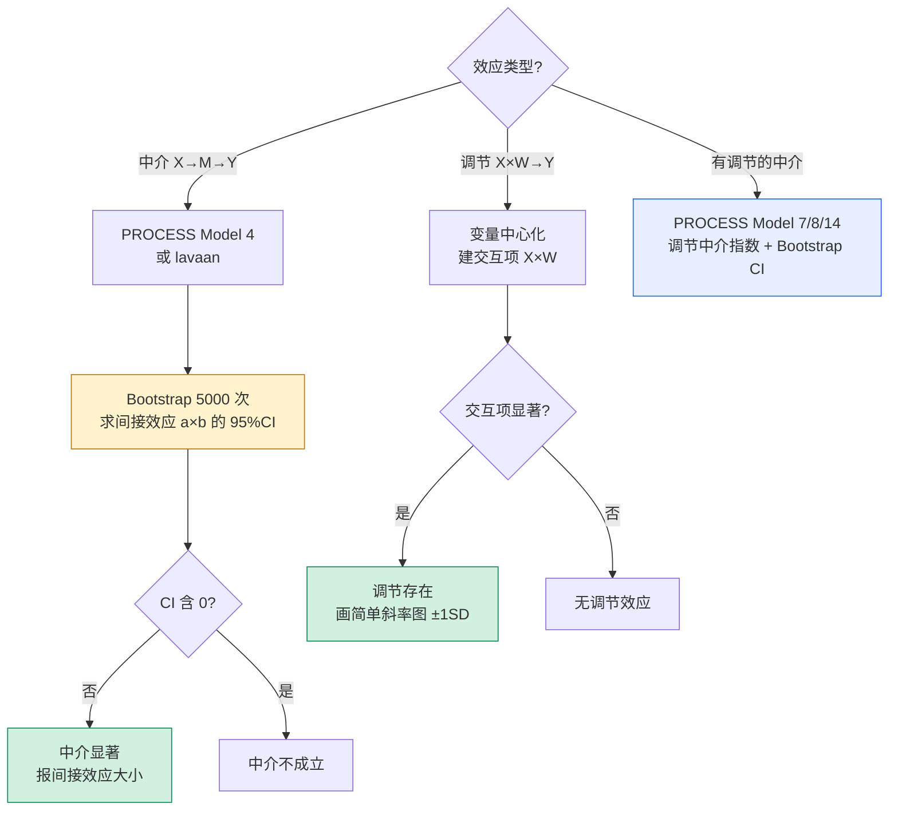

# 问卷数据分析流程图 / Analysis Flowcharts

> Mermaid 图，GitHub 直接渲染。需要图片时打开同目录 `index.html` 截图，或贴到 https://mermaid.live 导出 SVG/PNG。

## 图 1 · 问卷数据分析总流程 / Overall Workflow

## 图 2 · 分析方法决策树 / Which Test to Use

## 图 3 · EFA / CFA 选择与信效度判定 / EFA vs CFA

## 图 4 · 中介 / 调节分析流程 / Mediation & Moderation

> 提醒：中介判定看 **Bootstrap 95%CI 是否含 0**（不含 0 才显著），不要再用过时的 Baron-Kenny 逐步法单独下结论。详见 [`../references/07-sem-mediation.md`](../references/07-sem-mediation.md)。
